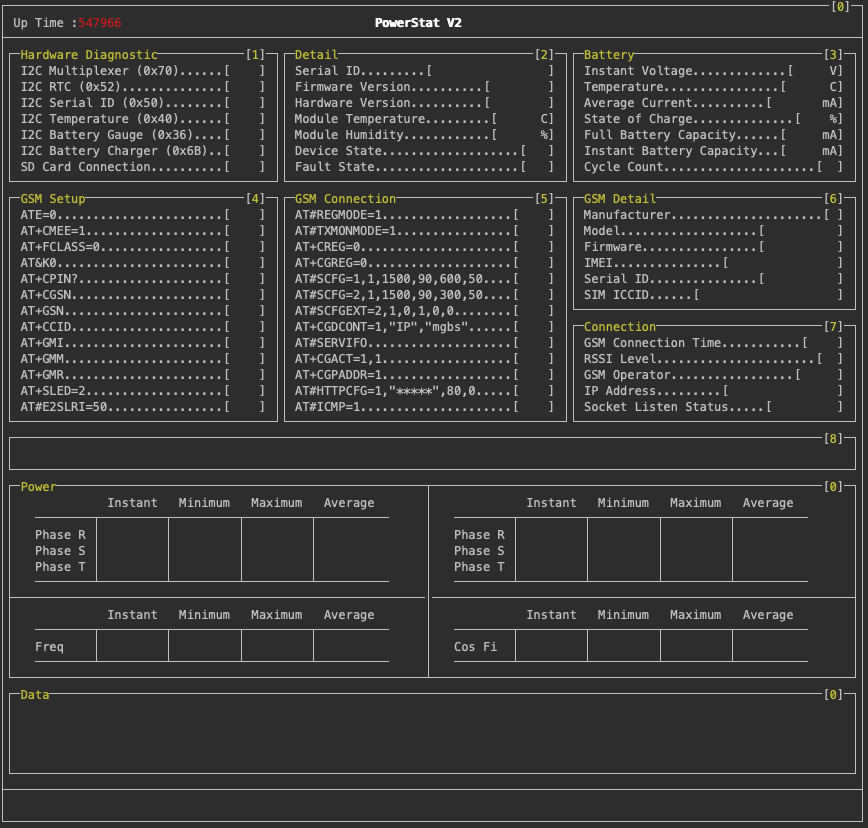

# VT100 Console Library ^V1.8^

     

---

## Abstract

Virtual terminal sequences are control character sequences that can control cursor movement, color/font mode, and other operations when written to the output stream. Sequences may also be received on the input stream in response to an output stream query information sequence or as an encoding of user input when the appropriate mode is set.

Arduino based VT100 comparable serial console library. Designed for AVR microcontrollers — all string constants are stored in PROGMEM (flash memory) to minimize SRAM usage.



---

## Features

- Full VT100 / ANSI escape sequence support
- Cursor positioning, visibility control, and screen clearing
- Foreground color, background color, and text format (bold, dim, blink, etc.)
- State-buffered color/format output — redundant escape codes are suppressed
- Box drawing with optional header and footer dividers
- Horizontal and vertical line dividers
- HEX value printing for `uint8_t`, `uint16_t`, and `uint32_t`
- AT command status display with dot-fill and OK/FAIL result
- All string constants stored in PROGMEM — zero SRAM overhead for literals
- Works with any `Stream`-derived object (`Serial`, `Serial1`, `SoftwareSerial`, etc.)

---

## Installation

**Arduino Library Manager:** Search for `Console` and install.

**PlatformIO:** Add to `platformio.ini`:

```ini
lib_deps = akkoyun/Console
```

**Manual:** Copy the `src/` folder into your project and include `Console.h`.

---

## Quick Start

```cpp
#include <Console.h>

Console Terminal(Serial);

void setup() {
    Serial.begin(115200);
    Terminal.Begin();                                       // Hide cursor, clear screen, set white
    Terminal.Text(1, 1, _Console_YELLOW_, F("Hello!"));    // Row 1, Col 1, yellow text
}

void loop() {}
```

> **Coordinate system:** `_X` = row (line), `_Y` = column. Origin is top-left (1, 1).

---

## API Reference

### Constructor

```cpp
Console Terminal(Stream &_Serial);
```

Binds the console to any `Stream` object.

```cpp
Console Terminal(Serial);        // Hardware UART
Console Terminal(Serial1);       // Second UART
Console Terminal(softSerial);    // SoftwareSerial
```

---

### Terminal Control

#### `Begin()`

```cpp
void Begin(void);
```

Initializes the terminal: hides cursor, clears screen, sets text color to white, and waits 5 ms for the terminal to settle. Call once in `setup()`.

---

#### `Clear()`

```cpp
void Clear(const uint8_t _Type);
```

Clears part or all of the terminal output.

| `_Type` constant | Effect |
| --- | --- |
| `_Console_LINE_AFTER_CURSOR_` | Erase from cursor to end of line |
| `_Console_LINE_TO_CURSOR_` | Erase from start of line to cursor |
| `_Console_LINE_` | Erase entire current line |
| `_Console_SCREEN_` | Erase screen (cursor stays in place) |
| `_Console_ALL_` | Erase screen and move cursor to (1, 1) |

```cpp
Terminal.Clear(_Console_SCREEN_);
Terminal.Clear(_Console_LINE_AFTER_CURSOR_);
```

---

#### `Cursor()`

```cpp
void Cursor(const bool _State);
```

Shows (`true`) or hides (`false`) the terminal cursor.

```cpp
Terminal.Cursor(false);   // Hide cursor
Terminal.Cursor(true);    // Show cursor
```

---

#### `Set_Cursor()`

```cpp
void Set_Cursor(const uint8_t _X, const uint8_t _Y);
```

Moves the cursor to row `_X`, column `_Y`.

```cpp
Terminal.Set_Cursor(5, 20);   // Row 5, column 20
```

---

#### `Beep()`

```cpp
void Beep(void);
```

Sends the BEL character (`\x07`) to produce a terminal beep sound.

```cpp
Terminal.Beep();
```

---

### Color and Format

> Colors and formats are **state-buffered** — the escape code is only sent when the value actually changes, saving serial bandwidth.

#### `Text_Color()`

```cpp
void Text_Color(const uint8_t _Color);
```

Sets the foreground text color.

| Constant | Color |
| --- | --- |
| `_Console_BLACK_` | Black |
| `_Console_RED_` | Red |
| `_Console_GREEN_` | Green |
| `_Console_YELLOW_` | Yellow |
| `_Console_BLUE_` | Blue |
| `_Console_MAGENTA_` | Magenta |
| `_Console_CYAN_` | Cyan |
| `_Console_WHITE_` | White |
| `_Console_GRAY_` | Dark gray (bright black) |

```cpp
Terminal.Text_Color(_Console_GREEN_);
```

---

#### `Background_Color()`

```cpp
void Background_Color(const uint8_t _Color);
```

Sets the background color using the same color constants as `Text_Color()`.

```cpp
Terminal.Background_Color(_Console_BLUE_);
```

---

#### `Text_Format()`

```cpp
void Text_Format(const uint8_t _Format);
```

Applies or resets a text attribute (SGR).

| Constant | Effect |
| --- | --- |
| `_Console_RST_` | Reset all attributes (color + format) |
| `_Console_BRIGHT_` | Bold / bright |
| `_Console_DIM_` | Dim / faint |
| `_Console_UNDERSCORE_` | Underline |
| `_Console_BLINK_` | Blink |
| `_Console_REVERSE_` | Reverse video (swap fg/bg) |
| `_Console_HIDDEN_` | Hidden (invisible) |

> `_Console_RST_` resets **all** SGR attributes including colors. The internal color buffer is invalidated automatically so the next color call will re-send the escape code.

```cpp
Terminal.Text_Format(_Console_BRIGHT_);
Terminal.Text_Format(_Console_RST_);
```

---

### Text Output

#### `Text()`

```cpp
void Text(const uint8_t _X, const uint8_t _Y, const uint8_t _Color, const __FlashStringHelper * _Value);
void Text(const uint8_t _X, const uint8_t _Y, const uint8_t _Color, const char _Value);
void Text(const uint8_t _X, const uint8_t _Y, const uint8_t _Color, const char * _Value);
template<typename T>
void Text(const uint8_t _X, const uint8_t _Y, const uint8_t _Color, T _Value);
```

Positions the cursor at (`_X`, `_Y`), sets the color to `_Color`, then prints `_Value`. Accepts flash strings (`F()`), single chars, C strings, and any numeric type.

```cpp
Terminal.Text(1,  1, _Console_YELLOW_, F("Device Ready"));
Terminal.Text(3, 10, _Console_WHITE_,  'A');
Terminal.Text(5, 10, _Console_GREEN_,  voltage);      // float, int, etc.
Terminal.Text(7, 10, _Console_CYAN_,   myCharArray);
```

---

### Drawing Primitives

#### `Box()`

```cpp
void Box(const uint8_t _X1, const uint8_t _Y1,
         const uint8_t _X2, const uint8_t _Y2,
         const __FlashStringHelper * _Text,
         const uint8_t _Number = 0,
         const bool    _Header = false,
         const bool    _Footer = false);
```

Draws a box from (`_X1`, `_Y1`) top-left to (`_X2`, `_Y2`) bottom-right using box-drawing characters. Prints `_Text` as the title in the top-left corner.

| Parameter | Description |
| --- | --- |
| `_X1`, `_Y1` | Top-left corner (row, col) |
| `_X2`, `_Y2` | Bottom-right corner (row, col) |
| `_Text` | Title string (flash string) |
| `_Number` | If > 0, prints a zero-padded number `[01]` in the top-right area |
| `_Header` | If `true`, draws a horizontal divider 2 rows below the top edge |
| `_Footer` | If `true`, draws a horizontal divider 2 rows above the bottom edge |

```cpp
Terminal.Box(1, 1, 20, 40, F("Sensors"), 1, true, false);
```

---

#### `Divider()`

```cpp
void Divider(const bool    _Type,
             const uint8_t _X,
             const uint8_t _Y,
             const uint8_t _Length,
             const bool    _End = false);
```

Draws a straight line divider.

| Parameter | Description |
| --- | --- |
| `_Type` | `_Console_HORIZONTAL_` or `_Console_VERTICAL_` |
| `_X`, `_Y` | Start position (row, col) |
| `_Length` | Total length including end connectors |
| `_End` | If `true`, draws junction connectors (`├`, `┤` or `┬`, `┴`) at both ends |

```cpp
Terminal.Divider(_Console_HORIZONTAL_, 10, 1, 78, true);
Terminal.Divider(_Console_VERTICAL_,   1, 40, 20, true);
```

---

#### `Dot()`

```cpp
void Dot(const uint8_t _X, const uint8_t _Y, const uint8_t _Count);
```

Prints `_Count` dot characters (`.`) starting at (`_X`, `_Y`) in gray. Used as a visual separator or fill pattern.

```cpp
Terminal.Dot(5, 15, 20);
```

---

#### `Space()`

```cpp
void Space(const uint8_t _X, const uint8_t _Y, const uint8_t _Count);
```

Prints `_Count` space characters starting at (`_X`, `_Y`). Used to erase a fixed-width field before re-drawing it.

```cpp
Terminal.Space(5, 15, 20);
```

---

#### `Bracket()`

```cpp
void Bracket(const uint8_t _X, const uint8_t _Y, const uint8_t _Size);
```

Prints a `[` at (`_X`, `_Y`) and a `]` at (`_X`, `_Y + _Size`) in white. Useful for creating a fixed-width value placeholder.

```cpp
Terminal.Bracket(5, 15, 8);   // Prints: [        ]
```

---

### AT Command Display

These two functions work together to display a GSM AT command status line with dot-fill and a result indicator.

#### `AT_Command()`

```cpp
void AT_Command(const __FlashStringHelper * _Command);
```

Clears the AT status area and prints the command text followed by dot fill and a `[ .. ]` waiting indicator.

```cpp
Terminal.AT_Command(F("AT+CREG?"));
```

---

#### `OK()`

```cpp
void OK(const bool _Result);
```

Replaces the `[ .. ]` waiting indicator with `[OK  ]` (green) or `[FAIL]` (red).

```cpp
Terminal.OK(true);    // [OK  ]
Terminal.OK(false);   // [FAIL]
```

> The AT status area position is configurable via `_Console_AT_Status_X_` and `_Console_AT_Status_Y_` (see Configuration).

---

### HEX Output

#### `Print_HEX()`

```cpp
void Print_HEX(const uint8_t _X, const uint8_t _Y, const uint8_t _Color, const uint8_t  _Value);
void Print_HEX(const uint8_t _X, const uint8_t _Y, const uint8_t _Color, const uint16_t _Value);
void Print_HEX(const uint8_t _X, const uint8_t _Y, const uint8_t _Color, const uint32_t _Value);
```

Prints a hex value at the given position with a `0x` prefix. Each byte is zero-padded to two digits.

| Type | Output example |
| --- | --- |
| `uint8_t` | `0xFF` |
| `uint16_t` | `0x04D2` |
| `uint32_t` | `0xDEADBEEF` |

```cpp
Terminal.Print_HEX(5, 10, _Console_CYAN_,  (uint8_t)0xAB);
Terminal.Print_HEX(6, 10, _Console_CYAN_,  (uint16_t)0x1234);
Terminal.Print_HEX(7, 10, _Console_CYAN_,  (uint32_t)0xDEADBEEF);
```

---

## Helper Functions

### `SELECT_COLOR()`

```cpp
template<typename T>
inline uint8_t SELECT_COLOR(const T _VALUE, const T _MIN, const T _MAX);
```

Returns a color constant based on a value compared against a range. Accepts any numeric type (`uint8_t`, `int`, `float`, etc.).

| Condition | Returned color |
| --- | --- |
| `_VALUE <= _MIN` | `_Console_RED_` |
| `_VALUE >= _MAX` | `_Console_GREEN_` |
| In between | `_Console_WHITE_` |

```cpp
uint8_t battery = 75;
Terminal.Text(5, 10, SELECT_COLOR(battery, 20, 80), F("Battery"));
// RED if <= 20, GREEN if >= 80, WHITE otherwise
```

---

## Configuration

Define these **before** including `Console.h` to override the default AT status area position:

```cpp
#define _Console_AT_Status_X_   21    // Row of the AT command status line
#define _Console_AT_Status_Y_   84    // Column of the AT command status line
#define _Console_Message_X_     21    // Row of the message area
#define _Console_Message_Y_     4     // Column of the message area
#include <Console.h>
```

---

## Memory Notes

- All string constants (`\e[`, box-drawing characters, escape sequences, `"OK"`, `"FAIL"`, etc.) are stored in PROGMEM flash via `static const char[] PROGMEM`.
- Color and format state is cached in a 3-byte struct — redundant VT100 codes are never sent.
- No dynamic allocation (`new` / `malloc`) is used anywhere in the library.

---

## Platforms

| Platform | Status |
| --- | --- |
| Arduino AVR (Uno, Mega, Nano) | Supported |
| MegaCore (ATmega2560, ATmega1284) | Supported |
| Any Arduino-compatible `Stream` | Supported |

---

[](https://www.patreon.com/bePatron?u=62967889)    [](mailto:akkoyun@me.com) 
